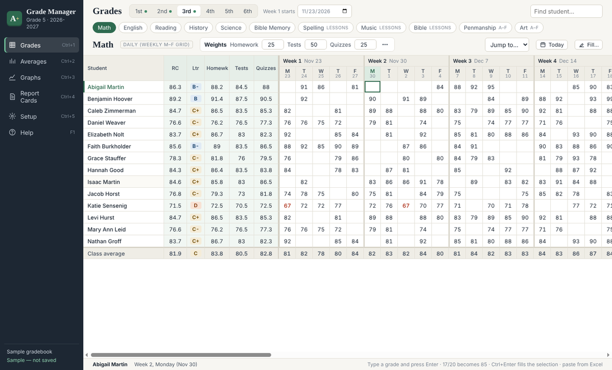
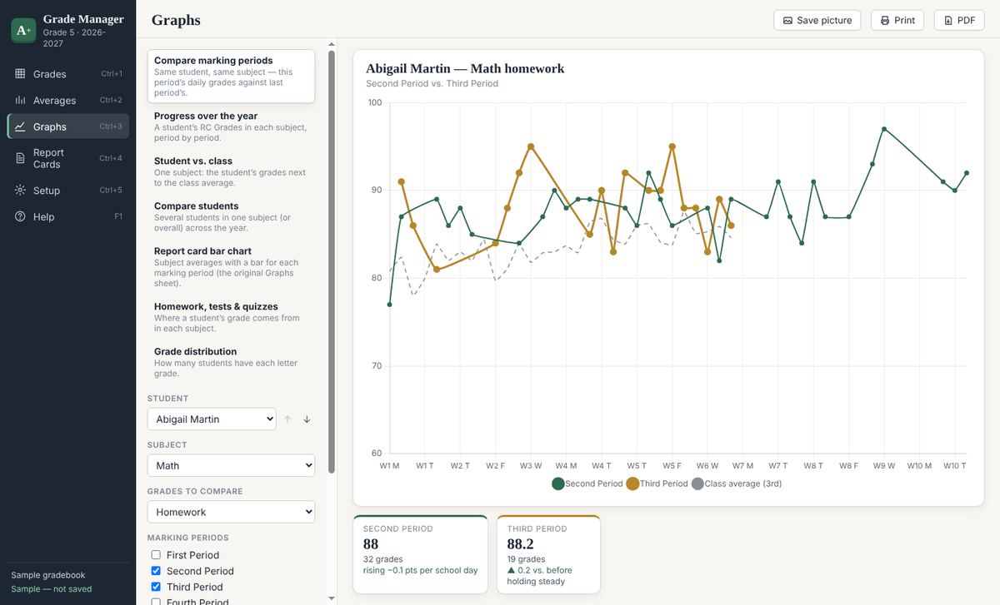
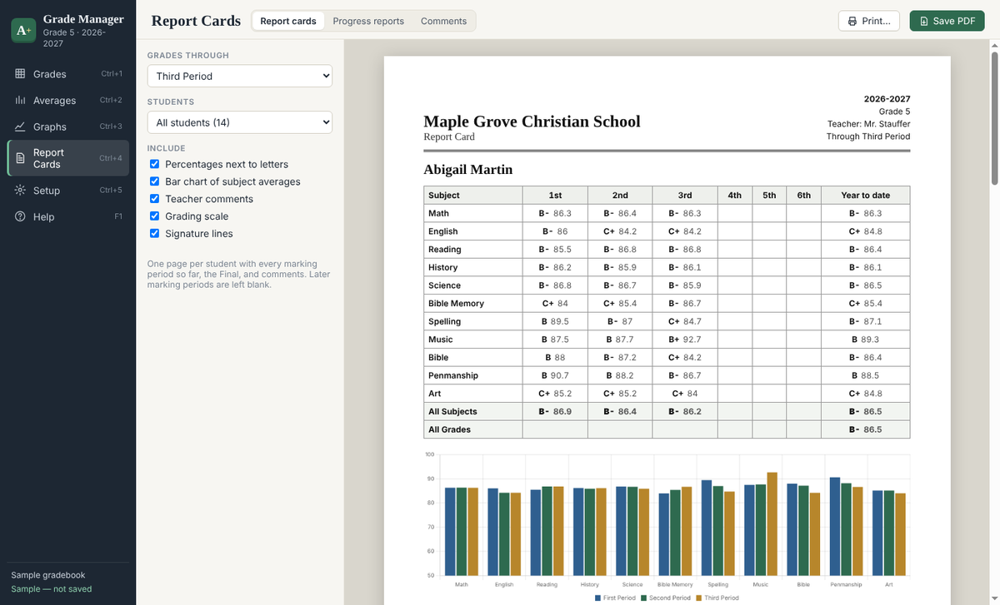

# Grade Manager

A fast, offline desktop grade book for Windows, Mac and Linux. It replaces the Excel **Grade Manager** workbook and does everything the workbook does:

- weekly Monday–Friday grade sheets
- weighted report-card grades
- the Averages sheet and the per-student graphs

It also adds Excel-style bulk entry, more graphs for comparing grades over time, report cards and progress reports, and automatic saving with backups.



## Download

Go to **[Releases](https://github.com/HandyFox/grade-manager/releases)** and download the file for your computer:

| Computer | File | Notes |
|---|---|---|
| Windows | `Grade-Manager-Setup-x.y.z.exe` | If Windows shows “Windows protected your PC”, click **More info → Run anyway**. The app isn’t code-signed. |
| Mac | `Grade-Manager-x.y.z-mac.dmg` | Drag the app to Applications. The first time, **right-click it → Open**. If macOS says it’s damaged, run `xattr -cr "/Applications/Grade Manager.app"` in Terminal. |
| Linux | `.AppImage` or `.deb` | For the AppImage, mark it executable and run it. |

No internet connection or account is needed. Your grades never leave your computer.

## Coming from the Excel Grade Manager?

Open the app and choose **Import from the spreadsheet**, or use **File › Import from Grade Manager Spreadsheet…**. Pick your `.xltm`, `.xlsm` or `.xlsx` file. The import brings in:

- students and subjects
- every grade in all six marking periods
- the homework/test/quiz weights for every subject in every marking period
- the letter-grade scale
- the Penmanship/Art letter chart

Your spreadsheet isn’t changed.

## Features

### Everything from the spreadsheet

- **The same subject layouts**:
  - **Daily** subjects (Math, English, Reading …) have a 10-week Monday–Friday homework grid, 12 tests and 15 quizzes.
  - **Lessons** subjects (Spelling, Music, Bible) have 15 lessons, 9 tests and 9 quizzes.
  - **Letter-graded** subjects (Penmanship, Art) take letters A+ … F, converted with an editable chart. The old code numbers (1 = A+, 2 = A …) still work.
- **RC Grade**: a weighted average of homework, tests and quizzes, with weights per subject per marking period. If a category has no grades yet, the other categories share its weight, just as in the spreadsheet.
- **Averages**: All Subjects for each marking period, the Final for each subject, Final across all subjects, and All Grades. Each comes with its letter grade from your editable scale.
- **Graphs**: each student's subject averages with one bar per marking period, plus class averages.
- **Flexible size**: any number of students, subjects and marking periods. Change the number of weeks, school days, tests, quizzes and lessons whenever you need to.
- **Subject buttons** jump to each subject. **Ctrl+PageUp/PageDown** moves to the previous or next subject.

### Quick bulk entry

- Type a grade and press **Enter** to move to the next student. At the bottom of a column it wraps to the top of the next one.
- Type **points** like `17/20` and they're converted to `85`.
- **Paste a block** of grades straight from Excel or Google Sheets. Paste one grade to fill the whole selection.
- **Ctrl+Enter** puts what you typed into every selected cell.
- **Fill…** gives everyone who doesn't have a grade yet a 100 (or any grade you choose).
- **Ctrl+D** fills down. **Delete** clears the selection. **Undo/redo** works for every grade change.
- Select a column by clicking its header, or a row by clicking a student's name.
- Set each marking period's start date to see real dates over the columns. **Today** jumps to today's column.
- Name tests, quizzes and lessons (for example "Ch. 3 Test") by double-clicking the column header.
- The RC grade, letter and category averages update as you type. Low grades are shown in red, and there's a class average under every column.

### Graphs for comparing grades over time



- **Compare marking periods**: one student and subject, this period's daily grades laid over last period's, day by day or as weekly averages. Options:
  - a running average line
  - a dashed class-average line
  - trend and change summaries
- **Progress over the year**: every subject's RC grade, period by period, with All Subjects highlighted.
- **Student vs. class**: one subject, with the homework, test and quiz breakdown.
- **Compare students**: several students in one subject, or All Subjects, across the year.
- **Report card bar chart**: the chart from the original Graphs sheet.
- **Homework, tests & quizzes**: shows which category is pulling a grade up or down.
- **Grade distribution**: how many students have each letter grade.

Every graph can be saved as a picture, printed, or saved as a PDF.

### Report cards and progress reports



- **Report cards** show every marking period so far plus Final or year to date. They can include a bar chart, your comments, the grading scale and signature lines.
- **Progress reports** cover one marking period: homework, test and quiz averages, the RC grade, the change since last period, low grades flagged, and a chart.
- A **Copy sheet** for filling in printed report cards by hand. Each student's grades are laid out in the same row order as the paper card (Bible, Bible Memory, Reading, English, Arithmetic, …, Typing), with marking periods 1–6 and Avg. Grades are written the way they go on the card ("B+ 92", or just "A" for Penmanship and Art), and the column you're copying is shaded. You can also print one marking period for the whole class on a single page. Row names and order are adjustable.
- Print or save a PDF for one student or the whole class, one page each.
- A **Comments** page for writing each student's comments for each marking period.

### Your data is safe

- Each gradebook is one file (`.gradebook`) that you choose where to keep, such as Documents or a OneDrive/Dropbox folder.
- **Every change is saved automatically.** A backup copy is kept every 10 minutes while you work (the last 60). Restore one from **File › Backups**.
- **File › Export to Excel** writes everything to a spreadsheet: report-card grades, averages, and every grade laid out like the original.
- **File › Start a New School Year** keeps your subjects, weights and scale and starts with empty grades.
- Students marked **withdrawn** keep their grades but are left out of class averages.

## How grades are calculated

These are the same formulas as the spreadsheet:

| | |
|---|---|
| Homework / Tests / Quizzes | Average of the grades entered (blank cells are skipped) |
| RC Grade | (Homework × w₁ + Tests × w₂ + Quizzes × w₃) ÷ (sum of the weights for the categories the student has grades in) |
| Letter-graded subject | Average of the letters' chart values |
| All Subjects | Average of a marking period's RC grades |
| Final (subject) | Average of that subject's RC grades across marking periods |
| Final – All Subjects | Average of the subject Finals |
| All Grades | Average of the marking periods' All Subjects averages |
| Letter | Highest scale row whose minimum is ≤ the percentage |

There is one small, deliberate difference. In the spreadsheet, a category whose average was exactly 0 (for example, a single missed assignment scored 0) was quietly left out of the RC grade. Here a 0 counts like any other grade.

## Building from source

You need [Node.js](https://nodejs.org) 20 or newer.

```bash
npm install
npm start            # run the app
npm test             # unit tests: grade math, import/export
npm run smoke        # automated UI walk-through with screenshots (Linux needs xvfb)
npm run dist         # build installers for the current OS into dist/
```

### Making a release

Push a version tag. GitHub Actions then builds the Windows, Mac and Linux installers and attaches them to a GitHub Release:

```bash
npm version patch    # or minor / major
git push --follow-tags
```

You can also start the **Test & build installers** workflow by hand from the Actions tab. That downloads the installers as build artifacts without making a release.

## Project layout

```
src/shared/model.js     gradebook data model (students, subjects, periods, grades)
src/shared/calc.js      all grade calculations
src/main/               Electron main process: files, autosave, backups, menus, printing,
                        spreadsheet import (importer.js) and Excel export (exporter.js)
src/renderer/           the app window: views/grades.js (grid), averages, graphs, reports, setup
test/                   unit tests
```

## Credits

Based on the Excel Grade Manager designed by Keith R. Martin, with modifications by Ryan Stauffer. Charts by [Chart.js](https://www.chartjs.org); Excel files by [SheetJS](https://sheetjs.com). MIT licensed.
